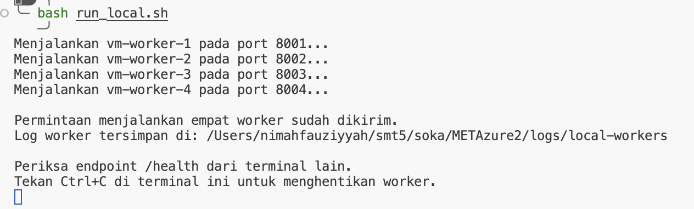
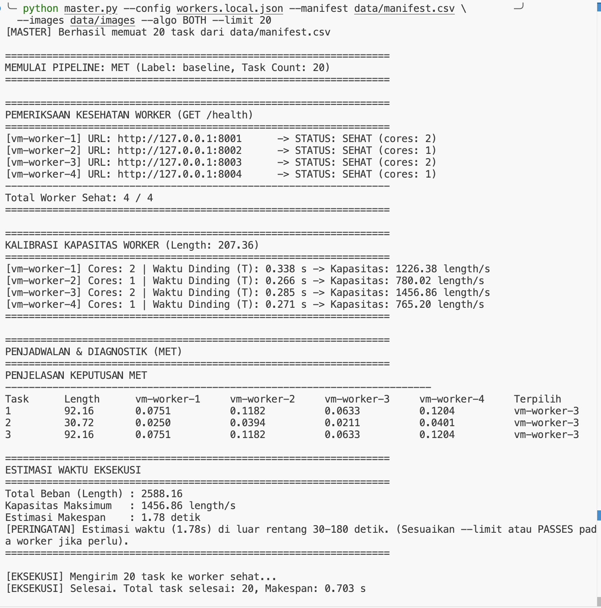
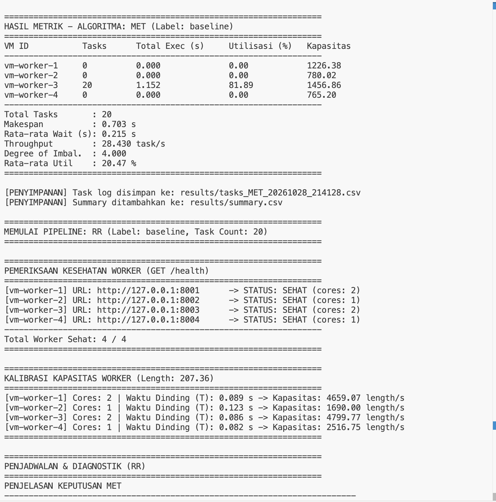
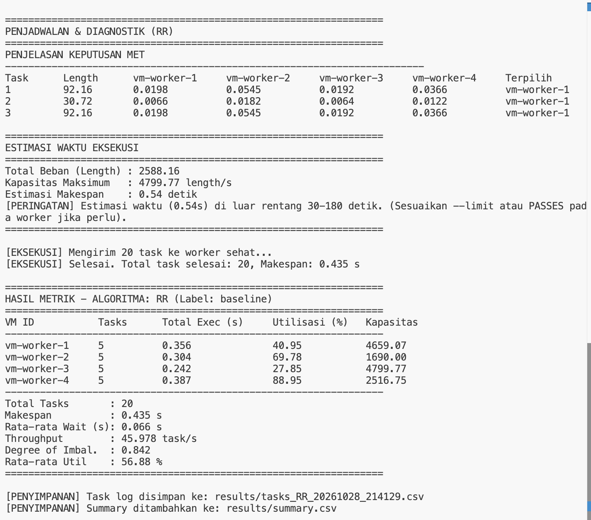
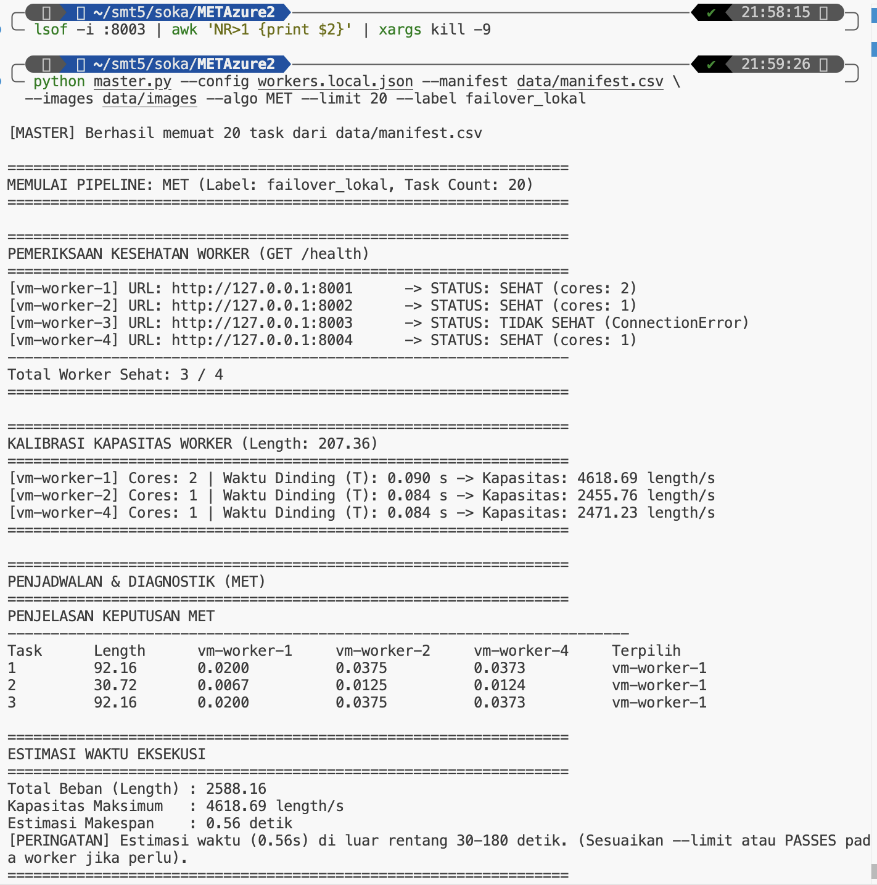
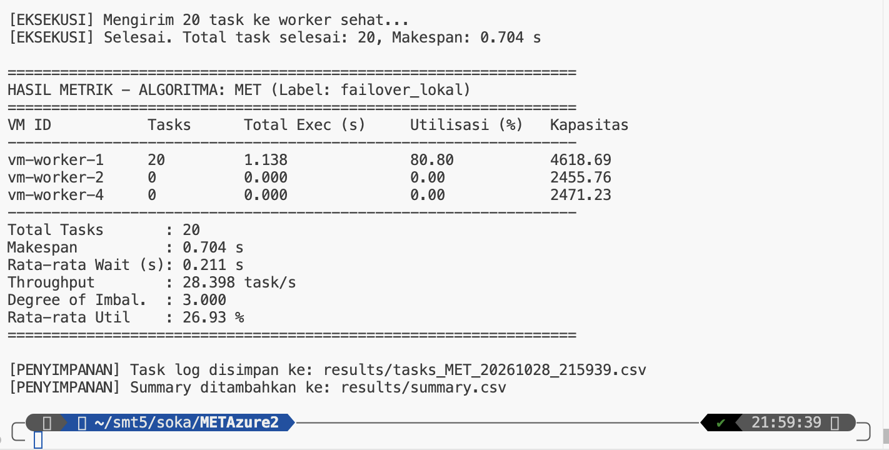

# uji coba master.py
## uji coba end-to-end lokal (Skenario T2)
```bash
# Start all 4 workers (2-core / 1-core / 2-core / 1-core)
./run_local.sh


# Run both algorithms with 20 tasks
python master.py --config workers.local.json --manifest data/manifest.csv \
                --images data/images --algo BOTH --limit 20
```

### hasil





## uji coba failover lokal (Skenario T3)
1. Matikan salah satu worker (misalnya port 8003):
```bash
lsof -i :8003 | awk 'NR>1 {print $2}' | xargs kill -9
```
2. Jalankan master kembali dengan label failover:
```bash
python master.py --config workers.local.json --manifest data/manifest.csv \
  --images data/images --algo MET --limit 20 --label failover_lokal
```

### hasil

Master mendeteksi vm-worker-3 berstatus TIDAK SEHAT (ConnectionError).


## uji coba di Cloud Azura (Skenario T4 s.d. T7)
1. SSH ke VM Master
```bash
ssh azureuser@<IP_publik_vm_master>
```

2. Jalankan Baseline 100 Task (T4):
```bash
python master.py --config workers.json --manifest data/manifest.csv \
  --images data/images --algo BOTH --limit 100 --label baseline
```

3. Uji Beban 300 Task (T5):
```bash
python master.py --config workers.json --manifest data/manifest.csv \
  --images data/images --algo BOTH --limit 300 --label load_300
```

4. Setelah Resize VM (T6):
```bash
python master.py --config workers.json --manifest data/manifest.csv \
  --images data/images --algo MET --limit 100 --label setelah_resize
```

5. Setelah Stop Satu VM (T7):
```bash
python master.py --config workers.json --manifest data/manifest.csv \
  --images data/images --algo MET --limit 100 --label failover
```


